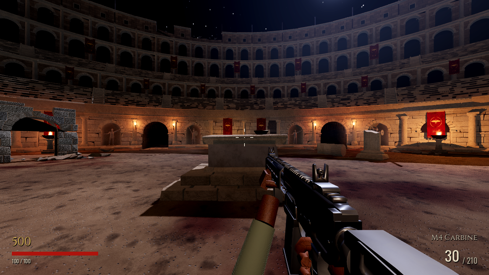
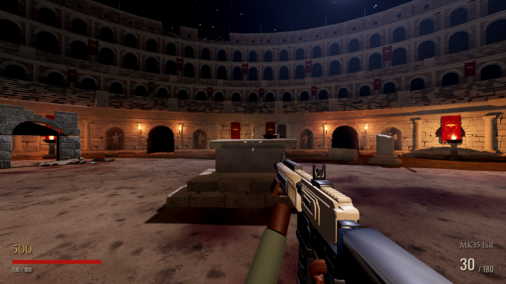

# Grok weapon integration

Branch `codex/grok-weapon-integration`, based on `2adf82f` (which includes
Claude's completed `visual-overhaul-phase1` at `5c07c25`). No merge into main.

## What is integrated

The active M4 GLB is now **Grok's Modern M4 LOD1**, not the earlier generated
rifle. **MK35 ISR** is a new automatic hitscan WeaponData resource in the normal
Mystery Box pool. Both use existing inventory, shooting, hits, zombie reactions,
HUD, audio playback, reload, switching and Pack-a-Punch systems.

M4 combat data and audio are retained. Only its presentation offsets changed
for the supplied grip/iron-sight geometry. Jupiter, M1911, zombie behavior,
Colosseum geometry/lighting/collision/navigation and the disabled-SSAO fix
remain unchanged. The shared viewmodel adds optional charging-handle and dust-
cover animation; weapons without those nodes retain their existing behavior.

No weapon was remodeled. A Godot import adapter rotates the supplied +X-forward
models to -Z-forward at unit metric scale, consolidates static geometry, and
keeps magazine+floorplate, bolt carrier, charging handle and dust cover as
separate assemblies at their supplied pivots. Their local axes are normalized
so the existing reload/bolt code moves in the correct directions. Hand and
muzzle markers are placed against the actual supplied geometry.

## Initial statistics

| Parameter | Existing M4 (unchanged) | New MK35 |
|---|---:|---:|
| Damage / head multiplier | 42 / 2.2 | 48 / 2.2 |
| Fire rate | 12.5/s (750 RPM) | 10/s (600 RPM) |
| Magazine / reserve | 30 / 210 | 30 / 180 |
| Reload | 2.3 s | 2.6 s |
| Effective / maximum range | 35 / 160 m | 35 / 160 m |
| Hip / ADS spread | 2.4 / 0.35 degrees | 2.4 / 0.35 degrees |
| Recoil pitch / yaw | 0.85 / 0.45 degrees | 1.05 / 0.4 degrees |
| Pack-a-Punch name | Legio Fulminata | Praetorian Tempest |
| Upgraded magazine / reserve | 40 / 315 | 40 / 270 |

MK35 trades slower cadence, less reserve and a longer reload for stronger
individual hits. It uses the existing upgrade multipliers: 2× damage, 1.334×
magazine, 1.5× reserve and 1.1× cadence, with the existing animated camo shader.
No unrelated weapon balancing changed. Box weights are M4 85, Jupiter 12,
MK35 40; adding MK35 changes the normalized chances to about 62%, 9%, 29%.
The M1911 remains the starting weapon and the inventory still has two slots.

## Source preservation and performance choice

All six original ZIPs are preserved under `assets/sources/grok/packages/`, with
SHA-256/size records in `assets/sources/grok/manifest.json`. Every supplied file
was extracted under `assets/sources/grok/original/`, including both editable
Blender files, full-detail glTF/bin/textures, LOD GLBs, reports and comparison
images. Attached reports were treated as asset documentation, not instructions
that override this task. The sources are ignored by Godot and excluded from
the playable export.

Godot independently loaded the full-detail and LOD exports and verified their
PBR textures and triangle counts. The active GLBs remain byte-for-byte copies
of the supplied LOD files. No Blender remodelling/export was done in this pass.

| Asset | Full detail | Selected LOD1 | Runtime surfaces |
|---|---:|---:|---:|
| Modern M4 | 40,588 triangles; 4K atlas | 18,238 triangles; 2K atlas | 5 |
| MK35 | 48,014 triangles; 4K atlas | 18,322 triangles; 2K atlas | 5 |

Each rifle shares one PBR atlas material with base color, OpenGL normal and
ORM maps. This saves about 55%/62% of full-detail geometry and uses one quarter
of the texture pixels. Static parts are combined without changing their
geometry; moving assemblies remain separate. This reduces 32/33 mesh objects
to five surfaces per rifle before arms, lighting and camo overlay passes.
These are practical budgets, not verified RX 560X frame-time measurements.

MK35 fire, upgraded fire and reload WAVs are original synthesis from
`tools/asset_gen/mk35_audio.py`, using the project's original synthesis helpers.
No commercial-game audio was imported. M4 keeps the existing original audio.

## Actual Godot screenshots

These are unretouched Godot 4.7.2 viewport captures of the actual game scene,
player, HUD and equipped weapons, rendered using Mesa llvmpipe/OpenGL. The
reload captures use a paused step of the real reload tween during magazine
removal. The lower magazine can leave the frame in this inherited pose; its
movement and return are checked in the integration tests. These are not the
supplied Blender/package comparison renders.

| View | M4 | MK35 |
|---|---|---|
| Hip | [M4](screenshots/m4_hip.png) | [MK35](screenshots/mk35_hip.png) |
| ADS | [M4](screenshots/m4_ads.png) | [MK35](screenshots/mk35_ads.png) |
| Reload | [M4](screenshots/m4_reload.png) | [MK35](screenshots/mk35_reload.png) |
| Animated upgrade | [M4](screenshots/m4_upgraded.png) | [MK35](screenshots/mk35_upgraded.png) |





## Verification

Raw logs are in [results](results/).

- Existing regression suite, extended with MK35 resource checks: **231 passed,
  0 failed**.
- Grok integration suite: **140 passed, 0 failed**, including real body/head
  hits on zombies, muzzle flash/bolt, reload transfer and magazine animation,
  charging-handle reset, HUD, normal weighted box acquisition, actual
  Pack-a-Punch interaction/charge/camo, switching, inventory replacement,
  duplicate acquisition, held automatic fire at zero ammo and reserve-limited
  auto-reload. Import checks cover all five maps and both LOD triangle counts.
- M4 animation/attachment suite: **28 passed, 0 failed**.
- Independent supplied export verifier: four exports loaded, **0 failures**.
- Real game-loop bot: **two rounds completed, 15 kills, 10 headshots** (63
  seconds simulated at 3× speed); `BOT_DONE`. This was scripted, not human play.
- Smoke: round 1 spawning, **185 navigation polygons**, `SMOKE_DONE`.
- Render capture completed all eight images with `GROK_CAPTURE_DONE`.
- Windows x86-64 release export succeeded using checksum-verified official
  Godot 4.7.2 templates. The executable has a valid PE header and embedded PCK;
  export logs include both rifles, textures, MK35 data/audio and the real box
  pool. Source packages are not exported. Distribution ZIP CRC was verified.

During testing, a fixed wall-clock box wait was too short when resource loading
stalled a frame. The test now waits for the actual offering state; gameplay
timing was not changed. Test runs still report existing shutdown resource/
ObjectDB leaks; these are recorded separately from passing gameplay checks.

## Run and rebuild

```bash
export PATH=/workspace/.arena-setup/bin:$PATH  # this cloud: Godot 4.7.2
cd /workspace/Arena-mortis-2-
python3 tools/asset_gen/install_grok_models.py
python3 tools/asset_gen/mk35_audio.py
godot --headless --path . --editor --import
godot --headless --path . res://tests/run_tests.tscn
godot --headless --path . res://tests/grok_integration.tscn
godot --headless --path . res://tests/m4_pipeline.tscn
godot --headless --path . -s tests/verify_grok_exports.gd
godot --path .
```

For captures, use a display and run `tools/preview/grok_capture.tscn` with
`--rendering-method gl_compatibility --rendering-driver opengl3`. This cloud
uses the installed Xorg dummy driver on `:99`. Do not run the arena generator.

For Windows export, install official 4.7.2 export templates and run
`godot --headless --path . --export-release "Windows Desktop" build/windows/ArenaMortis.exe`.
The provided distribution includes the EXE, controls/readme and an optional
OpenGL fallback launcher. Its checksum is delivered alongside the ZIP.

## What remains unverified

The Windows binary was **not launched**: this machine is Linux without Wine.
There was **no human mouse/keyboard playtest**, no listening session, no real
RX 560X benchmark and no Forward+ rendering validation. Screenshots and bot
tests establish integration, not target-hardware performance or game feel.
Original coarse glove/arm meshes and the game's procedural animation style
are retained; no new skeletal hand animation was authored. Existing SSAO stays
disabled. OpenGL reports the expected unsupported volumetric-fog/SSAA warnings.

GitHub publication status is reported in the delivery message; a local commit
or successful export is not evidence that a push succeeded.
