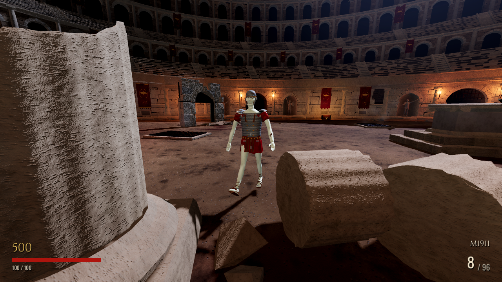

# Legionary zombie — Stage 1

Branch `codex/legionary-zombie-stage1` starts at verified local commit
`d29702d392aec50f6d07bf353722cc1e0c941540`. It preserves the Grok M4/MK35,
Claude's Colosseum and Gemini's compatibility fixes. Nothing is merged to main.

## Integrated asset

The active `assets/models/zombie_legionary.glb` is replaced. The existing zombie
scene still selects legionary/gladiator models normally; no AI, navigation,
collision, health, difficulty, wave, attack, weapon, box or upgrade code changed.
The same controller drives Emerge, Walk/Run, Attack, Hit and Death by name; its
head hurtbox still attaches to `Head`. Idle is used when the target is inactive.
The gladiator and player assets were not changed.

Blender 4.3.2 was actually run for mesh creation, rigging, keyframing, GLB export
and Cycles CPU rendering. This is procedural Blender modelling rather than a
hand-sculpted character. It includes tapered anatomical limbs, articulated
fingers/toes, a sculpted face surface with recessed sockets and asymmetrical
damage, an Imperial Gallic-style helmet/cheek and neck guards, segmented lorica,
overlapping shoulder plates, red tunic, belt/apron straps and caligae sandals.

Master: [Legionary_Zombie.blend](../../assets/sources/legionary_stage1/Legionary_Zombie.blend).
Export: [zombie_legionary.glb](../../assets/models/zombie_legionary.glb).
Rebuild: [Blender generator](../../tools/asset_gen/build_legionary_blender.py).
[Reusable asset conventions and limitations](../../assets/sources/legionary_stage1/ASSET.md).

## Real renders and comparison

All images below are actual Blender or Godot output. No concept art or generated
reference image was substituted. Before/after Godot captures use the same
cameras, model scale, scene and lighting. The archived original model is loaded
only by the comparison tool; it is not the active game model.

| View | Original Godot | New Godot | New Blender |
|---|---|---|---|
| Full front | [Before](before/front.png) | [After](after/front.png) | [Blender](blender/front.png) |
| Full back | [Before](before/back.png) | [After](after/back.png) | [Blender](blender/back.png) |
| Three-quarter | [Before](before/three_quarter.png) | [After](after/three_quarter.png) | [Blender](blender/three_quarter.png) |
| Face/helmet | [Before](before/face_helmet.png) | [After](after/face_helmet.png) | [Blender](blender/face_helmet.png) |
| Combat distance | [Before](before/combat_distance.png) | [After](after/combat_distance.png) | — |
| Colosseum lighting | [Before](before/colosseum_lighting.png) | [After](after/colosseum_lighting.png) | — |



[Animation demonstration — actual imported Godot playback](animation_demo.mp4).
It shows all seven clips, including the six requested animations. It is a
scripted studio recording, not a human gameplay recording. The arena captures
instantiate the real zombie scene and freeze a Walk pose for comparison; normal
AI behavior is exercised separately in the gameplay tests and bot session.

## Performance and rig

| Metric | Original | Replacement |
|---|---:|---:|
| Triangles, full detail | 8,272 | 37,168 |
| Materials / surfaces | 9 | 1 / 4 |
| Meshes | 1 | 4 |
| Bones | 18 | 52 |
| Animation clips | 7 | 7 |

The four clearly named mesh groups share a single atlas. Armor has rigid
one-bone weights; skin weights blend at joints and were checked for normalization.
At the unchanged cap of 24 active zombies, all-legionary full-detail geometry
would be 892,032 triangles before lighting/shadow passes. All instances share
three 2048×1024 texture maps: about 24 MiB RGBA texels, about 32 MiB with mipmaps
before GPU compression. Texture and bone costs are not multiplied by separate
materials for each equipment finish.

Godot's existing automatic-LOD import setting remains enabled. No separate
hand-authored LOD is delivered in this stage. The full-detail budget was chosen
to preserve face/finger and equipment detail; target RX 560X frame times and
worst-case crowds still need measurement on actual hardware. Software render
timings in the movie log do not predict RX 560X performance.

## Validation

Current logs are in [results](results/). The following ran on Godot 4.7.2:

- Character suite: **55 passed, 0 failed**. GLB/skin/PBR checks; named bones;
  normalized weights; actual bone transforms changing in every clip; advancing
  AnimationPlayer; normal spawning/Emerge/Walk/Run, navigation, attack damage,
  Hit, Death, timed corpse removal, M4/MK35 head-hurtbox hits and unchanged
  gladiator navigation/attack.
- Existing regression suite: **231 passed, 0 failed**.
- Weapon integration suite: **140 passed, 0 failed**.
- Fresh standalone Godot project: GLB imports without Arena Mortis code, with
  all 52 bones, seven clips and embedded PBR textures. Reopening the Blender
  master confirmed four meshes, all actions and packed images.
- Normal two-round bot simulation: **15 kills, 9 headshots**, `BOT_DONE`.
  This uses real spawning, navigation, player input actions, box acquisition,
  shooting and round progression; it is automated, not human playtesting.
- Actual Godot movie recording and eight Blender/Godot studio views plus arena
  comparisons. Clip availability is not inferred merely from a skeleton.
- Windows x86-64 release export with the official Godot 4.7.2 templates. Its
  executable/embedded PCK and distribution ZIP are validated during delivery.
- Protected scene, AI, weapon, wave, gladiator, environment and project files
  were compared with `d29702d` and remain unchanged.

The first character test sampled Attack after the state had ended. It was
corrected to observe attack playback during pursuit; game timing was unchanged.
Blender's missing denoiser was handled by disabling denoising and using 48 CPU
samples. Raw logs retain existing shutdown ObjectDB/resource leak messages.

## Reproduce

```bash
export PATH=/workspace/.arena-setup/bin:$PATH
cd /workspace/Arena-mortis-2-
blender --background --factory-startup --python tools/asset_gen/build_legionary_blender.py
godot --headless --path . --editor --import
godot --headless --path . res://tests/legionary_integration.tscn
godot --headless --path . res://tests/run_tests.tscn
godot --headless --path . res://tests/grok_integration.tscn
godot --path .
```

The historical character generator now preserves the Blender-authored legionary
instead of overwriting it. Do not run the whole arena/asset generator for this
stage. New Blender renders are generated by the dedicated script above.

With a display, run `tools/preview/legionary_capture.tscn -- res://docs/legionary_stage1/after`.
For the old model add the final argument `original` and choose the `before`
output directory. Cloud captures use `DISPLAY=:99 LIBGL_ALWAYS_SOFTWARE=1`
and `--rendering-method gl_compatibility --rendering-driver opengl3`.
Record `tools/preview/legionary_animation_demo.tscn` with Godot's
`--write-movie demo.avi --fixed-fps 24`, then transcode to MP4 with ffmpeg.

## Remaining review and limitations

The asset is playable and rigged, but fine facial anatomy and scarring remain
simplified and the visual result remains stylized. Foot planting is approximate;
armor/cloth contact can intersect in some poses. Human review is still needed
for the requested level of character realism and natural animation quality.
Passing tests does not establish that artistic quality is approved.

No human mouse/keyboard playtest, Windows execution, Forward+ appearance check
or RX 560X benchmark was possible here. Windows builds are exported on Linux
without Wine. The provided Windows ZIP is for independent testing. The existing
SSAO fix is preserved, and OpenGL captures report the expected unsupported
volumetric-fog/SSAA warnings.

The delivery message records the actual commit/push result. A local commit or
source ZIP is not evidence that the GitHub branch was published.
