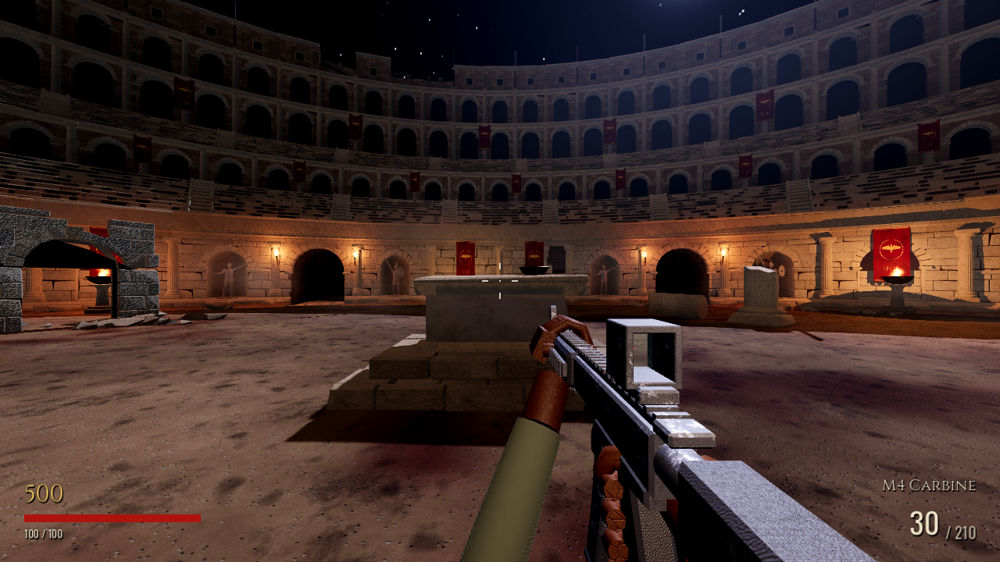
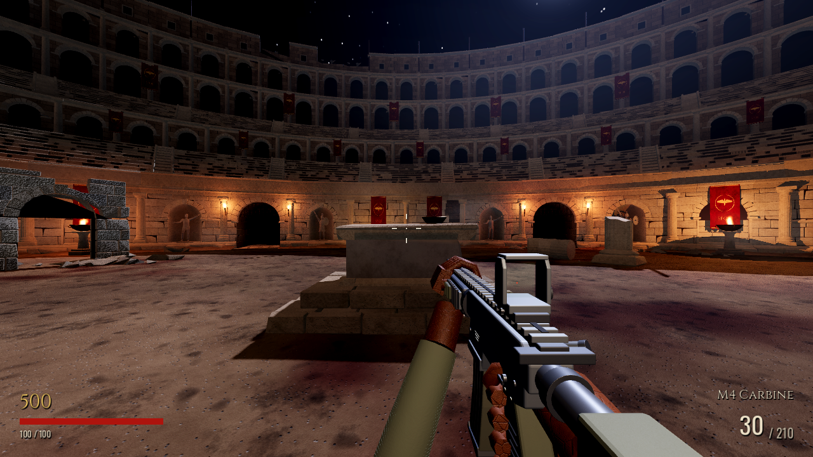
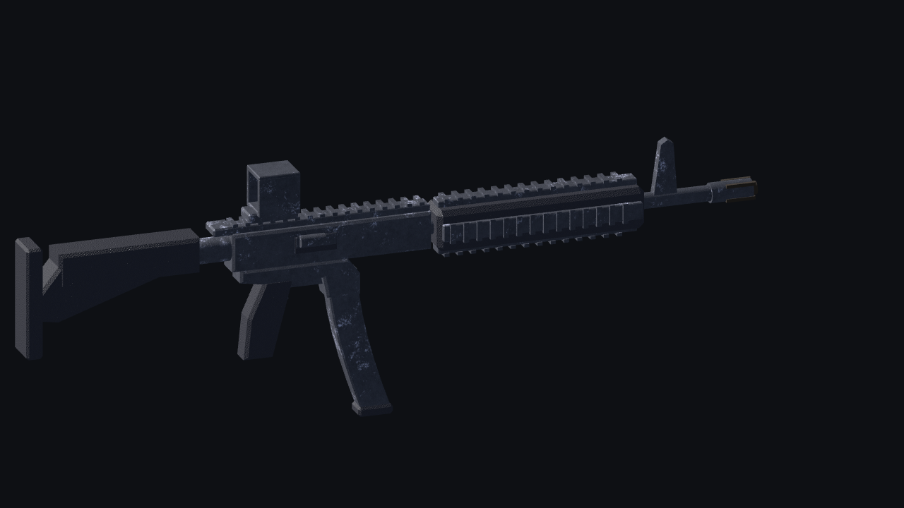
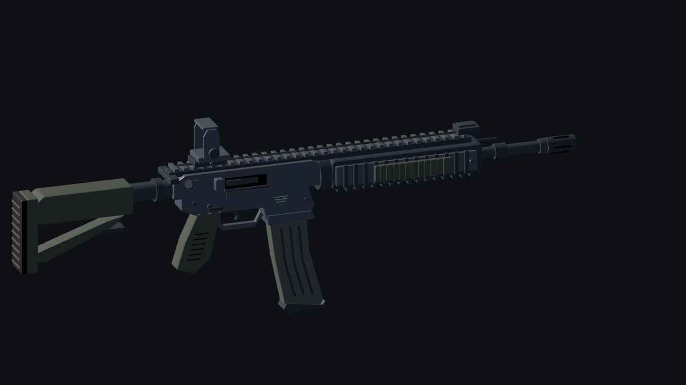

# M4 — Stage 1 review

Branch: `codex/m4-visual-stage1`, based on `visual-overhaul-phase1` at
`5c07c253db0c59571b7b4406d5d80b3567414869`. Only Stage 1 is implemented.
Nothing has been merged. Stage 2 and Stage 3 require review first.

## Actual Godot captures

Complete, unretouched 1280×720 viewport captures. The first four pairs use the
real `game.tscn`, HUD, player and WeaponManager with identical weapon offsets,
camera poses, FOV and lighting. The profile pair uses Godot with a neutral
studio environment and no arms. These are not Blender renders or concept art.

| View | Original | Stage 1 |
|---|---|---|
| Hip fire | [Original](before/hip.png) | [Improved](after/hip.png) |
| Aim down sights | [Original](before/ads.png) | [Improved](after/ads.png) |
| Fixed reload pose | [Original](before/reload_pose.png) | [Improved](after/reload_pose.png) |
| Pack-a-Punch | [Original](before/pack_a_punch.png) | [Improved](after/pack_a_punch.png) |
| Model profile | [Original](before/profile.png) | [Improved](after/profile.png) |

Original hip fire:



Stage 1 hip fire:



Original profile:



Stage 1 profile:



## Pipeline and changes

Blender **4.3.2 was executed** to verify availability and to build/export this
asset. The existing NumPy-to-GLB pipeline was inspected: it combines primitives
by material and supports named attachment nodes, but Blender provides a direct
editable source with bevel and weighted-normal tools.

- [Editable Blender source](../../assets/sources/m4_stage1.blend).
- [Rebuild script](../../tools/asset_gen/build_m4_blender.py).
- [Imported replacement](../../assets/models/weapon_m4.glb).
- Seven M4-only materials in `resources/materials/m4_*.tres` and a seeded
  microfinish roughness texture, `assets/textures/m4_finish.png`.
- Contoured upper/lower receiver, magwell, open trigger guard, angled grip,
  telescoping stock with open strut and ribbed butt pad.
- Slim rail system, ribbed insulating panels, fasteners, stepped barrel, gas
  tube, hollow flash hider and folded backup sight.
- Ejection-port recess, carrier, hinged dust cover, charging handle, forward
  assist, selector, receiver pins and witness markings.
- Curved STANAG magazine with pressed flutes and separate floorplate.
- Thin reflex hood using the existing glass and emissive red-dot materials.
  Separate finishes distinguish receiver, steel, polymer and magazine.

Static geometry is consolidated into one mesh with material surfaces. Bolt and
magazine remain separate animation targets. The existing GLB path and import
hook are retained. `Muzzle`, `RightHand`, `LeftHand` and `Sight` transforms are
preserved. No weapon data, firing/reload code, camo shader or shared weapon
materials changed. The existing animation setup is procedural, not a baked M4
animation clip. Arms still attach to the original hand anchors.

`build_weapons.py` now delegates M4 generation to Blender and fails explicitly
if it is unavailable, preventing accidental regeneration of the legacy M4.
Use the M4-only command below; do not regenerate the arena for this stage.

## Reproduce

```bash
export PATH=/workspace/.arena-setup/bin:$PATH  # cloud instance: Godot 4.7.2
cd /workspace/Arena-mortis-2-
blender --background --factory-startup --python tools/asset_gen/build_m4_blender.py
godot --headless --path . --editor --import
godot --headless --path . res://tests/run_tests.tscn
godot --headless --path . res://tests/m4_pipeline.tscn

# Requires an X display. This instance uses Xorg's dummy driver on :99.
DISPLAY=:99 LIBGL_ALWAYS_SOFTWARE=1 godot --audio-driver Dummy \
  --rendering-method gl_compatibility --rendering-driver opengl3 --path . \
  res://tools/preview/m4_capture.tscn -- res://docs/m4_stage1/after
```

Original captures used the baseline commit's M4 GLB with the same capture
script; the replacement was then regenerated and imported. Capture code is
`tools/preview/m4_capture.gd`. Fixed poses disable only that capture instance's
motion updates; production code is unchanged. The reload screenshot is a fixed
presentation pose; actual magazine motion is covered by the integration test.

## Verification and limits

Current-run logs and final counts are in [results](results/). The M4 integration
test exercises actual firing/ammo use, muzzle flash, bolt motion, magazine drop
and return, reload ammo transfer, hand transforms, material remapping and the
unchanged animated Pack-a-Punch shader.

The replacement has **26,200 imported triangles and 11 material surfaces**,
versus **2,240 triangles and 8 surfaces** in the baseline. This is one equipped
first-person model, not a model on each zombie. Capture draw calls are a
comparison, not target-hardware frame rates. Pack-a-Punch adds overlay passes
as before. Godot's profile view draws 26,172 triangles with automatic LOD.

Screenshots use Godot 4.7.2 Compatibility/OpenGL on Mesa llvmpipe, with existing
player and arena lighting. Forward+ appearance, live mouse/keyboard feel,
audible sound and target-GPU performance remain unverified. Existing arms are
still coarse and intersect the ADS view; their redesign and positioning belong
to Stage 2. SSAO remains disabled as on the starting branch. Arena architecture,
collision, materials, lighting and navigation have no changes in this pass.

Existing repository issues: `tests/menu_shot.gd:5` has an untyped-load inference
parse error that `check_scripts.gd` does not count. Forced game shutdown also
reports leaked objects/resources. Neither was introduced or fixed here.
